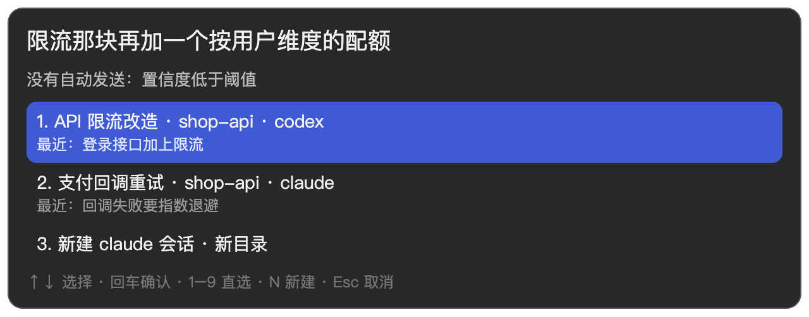
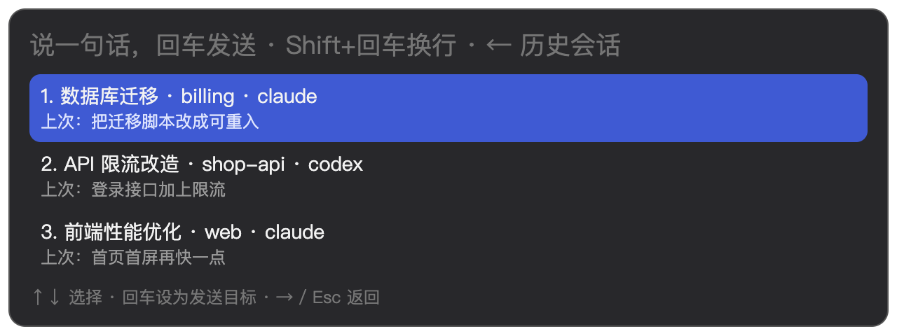

# Native Task Router

**按一个快捷键，说一句话，接着上次那个 AI 会话干活。**

**[⬇ 下载 macOS 版](https://github.com/hanzhangzzz/native-task-router/releases/latest)**（Apple 芯片）· [English](README.md) · macOS + iTerm2 / Terminal · Claude Code / Codex · MIT

https://github.com/user-attachments/assets/75bc1a02-bb3e-4efa-967e-06f264bb1f1c

**新开一个 AI 会话，等于让它失忆。** 最完整的上下文就在原生会话记录里，`claude -r` 和 `codex resume` 能把它原样恢复。难的是记住它在哪。

Native Task Router 替你记。它在你本机所有 Claude Code / Codex 会话里，找到这句话该去的那个，在你自己的 iTerm 或 Terminal 里续上；没有合适的，就新开一个。

```
以前   想起"限流那块还没做完"
       → 那是哪个项目来着？cd ~/code/shop-api
       → 当时用的 Claude 还是 Codex？codex resume
       → 在一长串会话里找到它，再把话敲进去

现在   ⌃⌥Space → "限流那块再加一个按用户维度的配额" → 回车
       → 那个会话正开着，就直接写进它的标签页（iTerm 或 Terminal），你不用切过去；它正在干活也照样写，原生会排到这一轮之后
       → 没开着，就新开一个标签页（Terminal 里是新窗口），用原生 resume 带着完整上下文续上
       → 把握没那么大，就分叉出一个新会话带着上下文接着干，原会话不动
```

先零风险试一下，它只告诉你会发去哪，不碰任何会话：

```bash
npm run ntr -- route "限流那块再加一个按用户维度的配额"
```

## 为什么不直接用 resume

| | 自己找 | 用它 |
| --- | --- | --- |
| 找到会话 | 记住项目目录和工具，`cd` 进去，再翻 resume 列表 | 说一句话，跨项目、跨 Claude Code / Codex 一起找 |
| 上下文 | 新开会话，或者靠记忆、摘要，都是压缩过的 | 原生 resume，完整的会话记录 |
| 界面 | 换一个新桌面 app，重新学一遍 | 还是你的 iTerm / Terminal 和原生 TUI；任务停下来等批准时，选项直接回到输入框里点一下 |
| 送错怎么办 | 不存在，因为全靠你自己 | 拿不准就让你选；中等把握的续接送进分叉，原会话不动 |

**它不和 Claude Code、Codex 抢饭碗。** 不跑 Agent，不托管终端，不替你批审批，只负责"这句话该去哪"。它们越强，它越好用；判断去处的路由模型也可以换。

## 下载安装

**用 Homebrew**：

```bash
brew trust hanzhangzzz/tap                              # 第三方 tap 要先信任，部分 Homebrew 版本否则拒绝加载
brew install --cask hanzhangzzz/tap/native-task-router
```

装好后从第 2 步继续。0.7.0 起有新版本时菜单栏图标旁会出现 ↑，点「更新到 x.y.z 并重启」原地升级（下载的包须与 Release 公布的 SHA-256 一致、且是同一张签名证书）；也可以用 `brew upgrade --cask native-task-router`。

**或者手动下载 dmg**：

1. 从 [Releases](https://github.com/hanzhangzzz/native-task-router/releases/latest) 下载 `Native-Task-Router-<版本>-arm64.dmg`，把应用拖进"应用程序"。目前只有 Apple 芯片版本。
2. **第一次打开会被 macOS 拦下**：应用没有经过苹果公证（作者没有开发者证书）。打开"系统设置 → 隐私与安全性"，在页面下方点"仍要打开"。也可以在终端执行 `xattr -dr com.apple.quarantine "/Applications/Native Task Router.app"`。
3. 打开后它常驻在菜单栏（图标是一个小气泡连到一颗星），默认开机自动启动。按 **Control+Option+Space** 唤起输入框；菜单里可以改快捷键、关掉开机启动、退出。
4. 第一次使用时，macOS 可能会询问是否允许它控制 iTerm（或 Terminal）和"系统事件"，点允许：它要据此找到你正在看的标签页，并把话写进去。

同样需要：iTerm2 或 macOS 自带的 Terminal、已登录的 Claude Code（`claude`，用来判断去处）；续 Codex 会话需要已登录的 `codex`。

## 从源码运行

**前置条件**：macOS、[iTerm2](https://iterm2.com) 或自带的 Terminal、Node.js ≥ 24（已在 25.5 上测试）、已登录的 [Claude Code](https://docs.claude.com/en/docs/claude-code)（`claude` 在 PATH 里）。要续 Codex 会话，还需要已登录的 `codex`。

> 默认用你本机的 `claude -p --model opus` 判断去处，走你自己的 Claude 订阅，不需要额外的 API key。每次判断会把候选会话的摘要片段发给 Anthropic，详见[数据与隐私](#数据与隐私)。

```bash
git clone https://github.com/hanzhangzzz/native-task-router.git && cd native-task-router
npm ci                                   # 会顺带下载 Electron

npm run ntr -- sessions                  # 它认识你的哪些会话（最近的在前）
npm run ntr -- route "帮我写一个统计 nginx 日志里每小时 5xx 数量的小脚本"
```

```
新建 claude 会话（会自动新建）
236 个会话 · 3862ms · opus
```

觉得判断靠谱，就把入口常驻起来，按 **Control+Option+Space** 说话：

```bash
npm run entry                            # 常驻入口（NTR_HOTKEY 可改快捷键）
scripts/login-item.sh install            # 可选：登录后自动启动；uninstall 撤销
```

## 入口怎么用



| 操作 | 作用 |
| --- | --- |
| 回车 / Shift+回车 | 发送 / 换行（输入框跟着内容长高） |
| ↑ ↓ + 回车 | 拿不准时在候选里选；也可以按 1–9 直选，N 新建 |
| ←（光标在开头） | 展开任务列表：上面是终端里正开着的任务（按标签页顺序，带状态和 Agent 最后说的话），下面是其余最近的会话；打字筛选，数字键直选，⌘N 在该项目新开。选中后这句话**确定地**发过去，不经过判断 |
| Esc | 关掉；没发出去的话，下次打开还在 |

输入框的界面语言跟随 macOS（中文或英文）；`NTR_LANG=zh` 或 `en` 可以指定。



### 在入口里批准（0.12.0 起）

任务在终端里停下来等批准（Claude Code 问 "Do you want to proceed?"、Codex 列出编号选项）时，这句话先扣住不送：问题和选项回到输入框里，↑↓ 或数字键选一项、回车确认。它替你在那个标签页里按下方向键和回车，等屏幕离开选项框，再把扣住的话自动送出去。

- 任务列表里等批准的任务标着「等批准」，选中后直接进选项；选完如果又冒出下一个要确认的，接着弹回来让你选。
- 选项按屏幕上从 1 开始的编号解析，方向键从当前高亮项出发逐项下移；屏幕已经不在选项框时不会按键，这句话照常送出。
- 只按方向键和回车两样键，别的地方不碰。

命令行也能做同样的事：`npm run ntr -- open "<一句话>"` 真实送达，`--pick claude:<会话id>` 指定目标，`--new claude|codex` 直接新建，`--answer <n>` 在目标停在选项框时代选第 n 项并把这句话送出去。

新建的会话放在 `~/ntr-tasks/<这句话的简称>-<编号>` 里；设置 `NTR_TASKS_DIR` 可以换一个目录。

## 语音唤醒（实验）

在菜单栏勾选 **「语音唤醒」**，然后说 **"小卡拉米"**（菜单栏「修改唤醒词…」可以换成任意 3～6 个汉字）和你要派的活，一口气说完或者听到"叮"一声再说都行。唤醒后弹出与快捷键相同的输入框，你说的话边说边出现在框里；说完倒计时 3 秒自动发送，期间按任意键停下来改，按 Esc 取消。结果显示在框里并读给你听；拿不准送到哪时照常在框里列出候选。框里原本有没发出去的话时，语音的字接在后面，不自动发送。

- 第一次打开时 macOS 会请求麦克风权限，App 会把约 130MB 的模型下到 `~/.ntr/cache/models`。
- 全程用 [sherpa-onnx](https://github.com/k2-fsa/sherpa-onnx) 和 [X-ASR](https://github.com/Gilgamesh-J/X-ASR) 中英模型离线识别，声音不出本机，也不落盘。每句话先在本地转成文字，再按拼音匹配唤醒词，容忍口语里的含糊读法（说成"小卡了你"也算）——但只认句首附近（前面最多两个字的垫字）：家里聊天长句里句子中段凑出的近音不会再触发唤醒（0.13.2 起）。每次唤醒会把触发的那句记进 `~/.ntr/cache/wake-log.jsonl`，再误触就能查到是哪句话。
- 中英混说可以（"用 Codex 跑一下 npm test"）。开发常用词和最近会话的项目名会作为热词交给识别模型，更容易写对。剩下认错的字可以在倒计时里改；路由和接活的 Agent 都是大模型，个别同音字不影响它们理解。
- 菜单栏的麦克风指示灯只在语音唤醒打开时亮，关掉就释放麦克风。在听的时候约占单核 2% 的 CPU、300MB 内存（语音模型）。
- 叫不醒时，先在「系统设置 → 声音 → 输入」调高输入音量。

收音端也可以单独在终端或另一台机器上运行（需要 ffmpeg）：

```bash
cd satellite && npm install && npm run models
npm start                          # NTR_VOICE_DEBUG=1 打印每句听到的话；NTR_WAKE_WORD=… 换唤醒词
npm start -- --wav x.wav           # 用 16kHz 单声道录音代替麦克风
```

`NTR_MIC=<序号>` 换输入设备（`ffmpeg -f avfoundation -list_devices true -i ""` 列出序号）。App 在 `127.0.0.1:47615`（`NTR_VOICE_PORT`）接收这句话，只接受带 `~/.ntr/voice-token` 里口令的请求，网页发不进来。

## 可选远程附加包

本仓库和公开安装包提供完整的本地桌面 App：输入框、会话索引、路由、原生终端投递、本地语音与更新功能均可独立构建和运行。0.14.0 起，手机网页、远程桥接、鉴权与中转实现由独立的私有附加包提供，不包含在本仓库或公开安装包中。

取得可信来源的附加包并解压后，在菜单选择「安装远程附加包…」，选中包目录并确认。附加包会以本机权限执行；格式与版本校验不代表安全认证。安装或更新后远程保持关闭，需要在菜单中主动打开；后续正常重启才恢复用户已打开的开关。

从 0.13.3 及更早的集成版升级前，请先取得附加包。未安装时只有本地功能；原有远程配置、令牌及任务历史不会删除。附加包放在 App 外，后续本地版升级仍会保留；卸载附加包也保留配置与历史。旧版公开源码、tags 和 Release 继续保留。

## 它怎么工作

```
一句话 ─▶ 本机会话索引 ─▶ 按项目归组，每个项目列最近几条线程 ─▶ Opus 选项目 + 线程（或新开） ─▶ 闸门 ─┬─▶ 写进正开着的终端标签页
                                                                                          ├─▶ 新标签页 claude -r / codex resume
                                                                                          ├─▶ 新标签页在该项目目录新建
                                                                                          └─▶ 中间档续接：新标签页分叉，原会话不动
```

- **索引**：直接读原生历史（`~/.claude/projects`、`~/.codex/sessions`），只收你亲手用过的交互式会话，排除 `claude -p`、`codex exec`、子代理和临时探针。Codex 0.163 起会把旧会话压成 `.jsonl.zst`，这些照样读（边读边解压，不改原文件）。增量缓存，热刷新几十毫秒；升级后第一次要重建索引，上千个 Codex 会话约 2 秒。
- **项目和线程一次选定**：会话按项目目录归组（最近活跃的 40 个项目），每个项目列出 14 天内最近活跃的至多 4 条线程（14 天内没有就列最近 1 条），每条带工具、多久前活跃、状态（正看着 / 开着 / 运行中 / 已关闭）和一行话题（首句与最近一句）。连同你的上一句一起交给模型，要它回答"属于哪个项目、续其中哪条线程，还是在项目里新开一条"（或者不属于任何已有项目），对项目和对线程各给一个置信度，再给理由和前三名。同一个项目里常常几件事并行，所以正看着哪个、哪个最近、哪个开着都只算弱证据，选哪条按这句话和各线程话题的相关度判断。
- **新开用哪个工具**：沿用该项目最近一个会话的工具；句子里明确点名（"用 codex …""让 Claude …"）就用点名的。记忆和 CLAUDE.md 由 Claude Code / Codex 自己加载。
- **闸门**：对项目要有 0.85 以上的把握，对线程（续哪条或该新开）要有 0.7 以上的把握，才自动送；哪一条不够就让你确认。
  - **项目 ≥ 0.95 且线程 ≥ 0.85，直接送达**：写进开着的标签页，或原生 resume 续上。
  - **其它自动续接，分叉送达**：也自动送，但不碰原会话。从那个会话分叉出一个新会话（`claude -r <id> --fork-session` / `codex fork <id>`），带着原会话的全部上下文，在新标签页里接收这句话；原会话的历史文件一个字节都不变，哪怕它正开在某个终端里。正文前加一行路由说明：这句话是自动送来的、置信度多少，如果与这个项目或会话无关，请说明原因并停下，不要改任何文件。
  - **判定新开，只在最有把握时自动新建**：项目 ≥ 0.95 时才在该项目目录新建（不属于任何项目就新建目录），不分叉；新会话正文前同样加一行说明：这句话是自动新建在项目 X 的，如果不属于这里，请说明原因并停下。把握不到 0.95 就让你确认，入口预选"在项目 X 新建"，回车即可。新建既没有原会话可以分叉保护，也没有已有会话做锚，所以门槛和直接送达一样高。
  - **把握不够，让你确认**：列出模型排好的几个项目，每个带它在该项目里的首选线程或新建，预选第一个，回车就送。
  - 模型出错、超时，一律不自动。你在入口里手动选的（← 任务列表、候选列表、新建）总是直接送达，不加说明。
  - 为什么要分叉档：送错时，这句话和 Agent 的回应会写进错的会话的原生历史，撤不回来；而"输入了先不回车、等你确认"又要求你一直盯着终端。分叉让中间这段既能自动，又不弄脏任何已有会话。线程选错在分叉档不弄脏原会话，代价是新会话少了你想接上的那段上下文。
- **短句不调模型**："继续""好的"这类没有内容的话，5 分钟内刚从入口发过一句就续那个会话；否则让你选，正看着的会话排第一，其余开着的按最近活跃排在后面。这条路几十毫秒。
- **送达前再核对一次**：要写进已开着的标签页，先确认"标签页 → 进程 → 会话"还是那个，也没有你打了一半的草稿。屏幕上停着审批框时不再拒送：这句话先扣住，审批的问题和选项回到入口里让你选（见上），替你按下方向键和回车、屏幕离开选项框后再自动送出。会话正在干活不拦：Claude Code 和 Codex 会把它排到当前这一轮之后。写进去后留在原地，不切到终端；任何一条不满足才切过去，把这句话放进剪贴板。同一个会话已经在跑，就绝不再开第二个进程去写它。
- **新会话开在哪个终端**：唤起输入框时你正看着的那个终端；否则开着的那个（两个都开着选 iTerm）；都没开就用 iTerm，没装 iTerm 才用 Terminal。设 `NTR_TERMINAL=iterm` 或 `NTR_TERMINAL=terminal` 可以固定。
- **Terminal 是新开窗口**：Terminal 的脚本接口只能新开窗口，开标签页得模拟按键，会抢焦点，所以不做。Terminal 没开着时先启动它、不多开空白窗口，窗口建好后切到前台（和 iTerm 冷启动一样）；Terminal 已经开着就不抢焦点。
- **iTerm 没开着**：先把它启动；如果它启动时自带一个空白窗口，就直接在那个窗口里续上或新建，不多留空标签页。

## 路由准不准

先说结论：**自动送出去的六分之五项目和线程都对，直接写进原会话的那一档没送错过项目；28% 的句子自动送达，其余让你按一次回车。**

在作者本机约一个月的真实历史上评测（[方法与完整数据](ops/research/route-accuracy-2026-10.md)）。留出集 253 条。一次自动送达算"全对"，要求项目和线程都对：续接要续到你当时回到的那个会话，新开要判定为新开。其中 31% 是"继续""好的"这类没内容的短句，离线没有入口语境，一律转确认。

**下面的数字是同一次留出集运行的事后过滤，不是独立验证。** 留出集只跑了一次（当时新建的门槛还是 0.85、线程闸是 0.7）；"新建只在 0.95 以上自动"这条规则是看到结果之后改的，表里是把它套在同一批结果上重新统计。线程闸 0.5（0.12.1 起的默认）同样是对这一次运行的事后重算——开发集上没有它能产生差别的样本，0.5 是看过这次结果后定的；入口日志自 0.12.1 起补记两个置信度，攒到真实分布后再回来调。

| | 自动（占 253 条） | 全对 | 项目对、线程错 | 项目错 | 直接写进原会话（项目错） | 分叉送达全对 | 自动新建全对 |
| --- | --- | --- | --- | --- | --- | --- | --- |
| 默认（线程闸 0.5） | 72（28%） | 59 | 10 | 3 | 14（0） | 43 / 53 | 4 / 5 |
| 线程闸 0.7（0.6.0–0.12.0 的设置） | 60（24%） | 50 | 7 | 3 | 14（0） | 35 / 42 | 3 / 4 |
| 线程闸 0 | 74（29%） | 59 | 12 | 3 | 14（0） | 43 / 55 | 4 / 5 |
| 0.5.0（模型只选项目，项目内按规则选会话） | 91（36%） | 68 | 17 | 6 | — | — | — |

- 和 0.5.0 比，自动送达少了，送出去的更准：全对从四分之三升到六分之五，项目错从 6 次降到 3 次，其中"自动新建到错的项目"从 6 次降到 1 次（按同一份留出集的同一口径计）。0.5.0 当时报告的是 70 / 17 / 4，因为没有核对新开落在哪个项目，有 2 条新开落在了错的项目；这里按"项目和线程都对"的口径重算。
- 想要更多自动送达，把 `NTR_ROUTER_THREAD_CONFIDENCE` 设成 0：自动约 29%，代价是线程错更多（都落在分叉档，原会话不受影响，只是新会话少了你想接上的上下文）。0.12.1 的默认 0.5 在两者之间：同一次运行里比 0.7 多 12 条自动、9 条全对，没有新增错项目，新增代价是 3 个错线程分叉。
- 剩下的 3 次项目错：2 次在分叉档，原会话没被改动；1 次是自动新建，那句话属于一个你新建的目录，被放进了已有项目。
- 每次判断 p50 约 5 秒、p90 约 8 秒，主要花在 `claude -p` 启动和 Opus 推理上；按 API 价格折算每次约 0.09 美元（订阅下不另计费）。短句快路径几十毫秒。

样本量有限，而且是作者一个人的使用习惯。这些数字说明的是在这批数据上的表现，不是通用错误率。

## 路由模型可替换

路由只管"这句话该去哪"，跟执行任务的 Claude Code / Codex 是两回事，模型可以换：

| 设置 | 效果 |
| --- | --- |
| （默认） | Opus，经本机 `claude -p`，用你的 Claude 订阅，不需要 API key |
| `NTR_ROUTER_MODEL=sonnet` | 换成 `claude -p` 支持的其他模型 |
| `NTR_ROUTER_MIN_CONFIDENCE=0.97` | 直接写进原会话所需的项目置信度（默认 0.95）；越高越少直接写进原会话 |
| `NTR_ROUTER_FORK_CONFIDENCE=0.9` | 自动送达所需的项目置信度（默认 0.85），低于它就让你确认；不能高于直接送达阈值，配错了直接报错 |
| `NTR_ROUTER_THREAD_CONFIDENCE=0` | 自动送达所需的线程置信度（0.12.1 起默认 0.5）；越高越少自动、线程越准，设 0 就不看线程，见上面的表 |
| `NTR_ROUTER_NEW_CONFIDENCE=0.97` | 自动新建所需的项目置信度（默认等于 `NTR_ROUTER_MIN_CONFIDENCE`）；不能低于分叉送达阈值，配错了直接报错 |
| `NTR_ROUTER_BACKEND=openrouter` + `openrouter_api_key` | 同一套候选、提示词和闸门，经 [OpenRouter](https://openrouter.ai) 调用；再用 `NTR_ROUTER_MODEL=deepseek/deepseek-v4.1-flash` 之类指定任意模型 |
| `NTR_ROUTER=interim` | 改用 OpenRouter Decisions 上的 Jev（`typesafe/jev-1.13`）来选 |

也可以自己实现 [`Router`](src/layers/types.ts) 接口，接入别的路由。提醒一句：闸门的阈值是按默认 Opus 标定的，别的模型给置信度的习惯不同。换模型之前，先用 `npm run ntr -- route` 在自己的会话上试试。

## 已知限制

- 只支持 macOS 上的 iTerm2 和 Terminal。在 Ghostty、Warp 等其它终端里开着的会话写不进去，只会提示你，并把这句话放进剪贴板。
- Claude Code 默认只保留 30 天历史，更早的会话续不上。
- Codex 用 `--remote` 新建的会话，判断不了它是否还在运行。
- 等批准按常见提问和"从 1 开始的编号选项"识别；别的样式认不出来，这时照常把这句话放进剪贴板并切过去，不代按任何键。
- 判断依赖 `claude` 已登录，而且偏慢：每次要等 `claude -p` 启动和 Opus 推理；短句快路径不调模型。

## 数据与隐私

- **留在本机**：会话索引缓存和入口记录都在 `~/.ntr/`（`cache/` 随时可删；`entry-log.jsonl` 是你从入口发过的记录，路由用它理解"继续"这类短句；0.3 以前叫 `~/.jev/`，第一次启动新版本时会原样改名）。不修改任何原生历史。
- 分叉送达会在原生目录里多出一个会话文件（Claude Code 在 `~/.claude/projects`，Codex 在 `~/.codex/sessions`），里面复制了原会话的内容，开头那句带着路由说明；原会话文件不变。用不上的分叉可以像普通会话一样删掉。
- **发出去的**：每次判断，把候选会话的有界片段（每张卡片的标题、首句、最近两句各约 120–160 字，加上回复片段）和你这句话，经你本机的 `claude -p` 发给 Anthropic；换成 OpenRouter 后端时，发给 OpenRouter 及它路由到的模型供应商（请求要求不留存、不训练）。发送前会遮掉形如 `sk-…`、`ghp_…`、`AKIA…`、`token=…` 的凭证。不会发送完整对话。
- 送达之后，内容由原生 Claude Code / Codex 按它们自己的方式处理。

## 开发

```bash
npm test                                 # 类型检查 + 全部离线契约（不碰终端、不调模型）
scripts/fresh-install.sh                 # 从零安装自检：干净克隆 → npm ci → npm test → 读会话 → 一次真实判断
npm run entry:ux                         # 入口界面验收（真实窗口 + 桩 CLI，不发真实消息）
NTR_LIVE_ITERM=1 npm run open:live       # 真实 iTerm 端到端：会在你的 iTerm 里建测试窗口、跑真实 claude/codex，默认不运行
NTR_LIVE_TERMINAL=1 npm run terminal:live  # 真实 Terminal 验收：只在自己新开的 Terminal 窗口里测，收尾逐个关闭，默认不运行
```

发版顺序：发 GitHub Release → `scripts/release-cask.sh <版本>` 同步 Homebrew cask → `scripts/verify-install.sh <版本>` 按陌生人的路径验证安装。后者在临时目录里用全新的 Homebrew 从 Release 重新下载安装，核对哈希、版本、签名、quarantine 与 Gatekeeper 评估，再用示例历史跑一次只判断不送达的路由；不碰本机 Homebrew、已装的 app 和你的会话数据，结束后全部删除。它覆盖不了"全新 macOS 上第一次打开"这一步。

分层代码在 [`src/layers/`](src/layers)：`providers/`（谁持有会话：claude、codex）、`surfaces/`（在哪展示：iterm、terminal，multi 负责分发）、`router/`（判断去处）、`open.ts`（编排）；入口在 [`entry/`](entry)。各层之间的合同见 [`src/layers/types.ts`](src/layers/types.ts)。

## 许可

[MIT](LICENSE)
